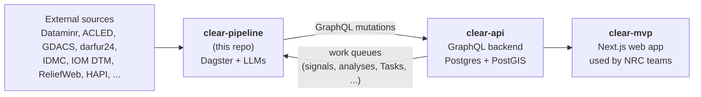

# clear-pipeline

The data pipeline behind **CLEAR** (Crisis Learning, Early-warning, Anticipation, and Response), a humanitarian decision-support platform built with the Norwegian Refugee Council (NRC). It pulls crisis signals and humanitarian reports from outside sources, uses LLMs to classify, group, extract and summarise them, and writes the results into the CLEAR API. It is a [Dagster](https://dagster.io/) project: every step is an asset you can see, run and replay in the Dagster UI.

It has no database of its own and no user interface for end users. Everything it produces goes into [clear-api](https://github.com/CLEAR-Initiative/clear-api) through GraphQL, and NRC teams see it in [clear-mvp](https://github.com/CLEAR-Initiative/clear-mvp).

## Where this fits



| Repo | Role |
|---|---|
| **clear-pipeline** (this repo) | Ingests signals and reports, runs LLM classification, grouping, extraction and generation, and writes the results to clear-api. |
| [clear-api](https://github.com/CLEAR-Initiative/clear-api) | The authoritative GraphQL backend. Owns the domain schema (Prisma, Postgres + PostGIS) and every database write. |
| [clear-mvp](https://github.com/CLEAR-Initiative/clear-mvp) | The Next.js web app NRC teams use on the ground in Sudan, Afghanistan and Venezuela. Reads from clear-api. |

Two rules hold across the system:

- **The pipeline never writes a database directly.** Every read and write goes through clear-api's GraphQL API ([`providers/clear_api.py`](src/clear_pipeline/providers/clear_api.py)), authenticated with an API key.
- **The work also flows the other way.** clear-api keeps durable queues (new signals, pending translations, analysis requests, Tasks, hotline messages). Sensors in this pipeline poll and drain them, so clear-api decides what needs doing and the pipeline does the expensive part.

The countries the pipeline covers come from clear-api's `pipelineCountries` (Sudan, Afghanistan and Venezuela today). Onboarding a country there is enough to add it here.

## What the pipeline does

Code lives in [`src/clear_pipeline/defs/`](src/clear_pipeline/defs/), one package per area. Dagster discovers it automatically (`load_from_defs_folder`).

| Area | Sources in | What comes out (in clear-api) | Main assets / jobs | Trigger |
|---|---|---|---|---|
| **Signals** ([`defs/signals`](src/clear_pipeline/defs/signals)) | Dataminr, ACLED, GDACS, darfur24, IOM DTM flash alerts (polled); IDMC, Sudan Witness (via the GX pipeline); analyst-created and pushed signals | Signals, grouped into Events, plus Alerts and translations | `raw_<source>` / `<source>_ingest`, then shared stages `classify_group`, `alert`, `translate` | Per-source poll sensors; downstream stages run eagerly |
| **Knowledge base** ([`defs/knowledgebase`](src/clear_pipeline/defs/knowledgebase), [`reliefweb_to_s3.py`](src/clear_pipeline/defs/reliefweb_to_s3.py)) | ReliefWeb reports and their PDFs, one-off manual uploads | Embedded, contextualised knowledge-base chunks; report figures; structured report datapoints and their aggregations | `reliefweb_weekly_knowledgebase` job (groups `reliefweb` + `reliefweb_kb`), `process_manual_document_job` | Weekly schedule, Tuesday 06:00 UTC, one run per country |
| **Situation analysis** ([`defs/situation`](src/clear_pipeline/defs/situation)) | The knowledge base and aggregated datapoints | One RAG-grounded situation analysis per country | `weekly_situation_analyses` (part of the weekly job) | Weekly, after the knowledge-base upsert |
| **On-demand and scheduled analyses** ([`defs/analysis`](src/clear_pipeline/defs/analysis)) | clear-api's analysis request and automation queues | Generated analyses for a user-chosen frame (locations, event types, sectors, time window) | `drain_analysis_requests`, `drain_analysis_automations` | Queue-drain sensors |
| **Hotline** ([`defs/ground`](src/clear_pipeline/defs/ground)) | WhatsApp hotline messages staged in clear-api | Classification and draft enrichment for review; voice-note transcripts | `ground_hotline_enrich`, `ground_transcribe` | Queue-drain sensors |
| **Location metadata** ([`defs/location_metadata`](src/clear_pipeline/defs/location_metadata)) | HAPI (UNHCR, OCHA, IPC, WFP, OPHI), OCHA 3W, IOM DTM, ACAPS, USGS | Baseline context per admin area (`locationMetadata`) | `location_metadata_daily`, `location_metadata_monthly`, `location_metadata_usgs` | Schedules (daily, monthly, every 10 min) |
| **Data-quality pipeline** ([`defs/gx_pipeline`](src/clear_pipeline/defs/gx_pipeline)) | Dataminr, ACLED, darfur24, IDMC, Sudan Witness | Bronze/silver/gold layers in S3 and Iceberg, gated by Great Expectations checks; signals pushed to clear-api | `<source>_gx` job: `<source>_bronze` ... `<source>_gold`, `<source>_push` | Manual, except IDMC (poll sensor) |
| **Task Worker** ([`defs/tasks`](src/clear_pipeline/defs/tasks)) | clear-api's generic Task queue | Completed Tasks | `drain_tasks` | Sensor; no Task kind is registered today |
| **Evals** ([`defs/evals`](src/clear_pipeline/defs/evals)) | Non-sensitive PDFs in `evals/reports/` | A leaderboard of cheaper models vs Claude (local only) | `model_replacement_eval` | Manual; see [evals/README.md](evals/README.md) |

How the knowledge-base chain works: ReliefWeb metadata and PDFs land in S3, then PDF text, then 800-token chunks, then LLM contextualisation and tag extraction, then embeddings, then `upsertKnowledgebaseChunks` in clear-api. In parallel, a six-domain datapoint extraction writes `report_datapoints`, and clear-api rolls them up at four tiers. See [docs/humanitarian-datapoint-extraction.md](docs/humanitarian-datapoint-extraction.md).

### Things to know before changing code

- **All LLM calls go through [`providers/llm.py`](src/clear_pipeline/providers/llm.py)** (`make_llm_provider(role)`). Each role (`context`, `extraction`, `datapoints`, `narrative`, `signal`, `translate`, `vision`) picks its provider and model from `LLM_<ROLE>_*` env vars, with an optional per-role fallback. Signal and event disaster-type classification uses Jev ([`providers/jev.py`](src/clear_pipeline/providers/jev.py)) through OpenRouter.
- **Extraction schemas are versioned.** Bumping a `SCHEMA_VERSION` (for example in [`datapoints_schemas.py`](src/clear_pipeline/defs/knowledgebase/datapoints_schemas.py)) re-extracts the whole back-catalogue, so bundle schema changes into one bump.
- **Adding a signal source** means adding a connector to `CONNECTORS` in [`defs/signals/connectors.py`](src/clear_pipeline/defs/signals/connectors.py). The factory builds its asset and sensor.
- **Use the domain vocabulary.** [CONTEXT.md](CONTEXT.md) defines terms such as Population Affected vs People in Need, Report vs Incident, and why unknown severity stays null. Design decisions live in [docs/adr/](docs/adr/).

## Quickstart

### Prerequisites

- [uv](https://docs.astral.sh/uv/getting-started/installation/)
- Python 3.10 to 3.14 (CI and the Docker image use 3.12)
- Redis, for the signal and queue drains (defaults to `redis://localhost:6379/0`)
- An S3-compatible bucket (AWS S3, Cloudflare R2, MinIO, ...)
- A running [clear-api](https://github.com/CLEAR-Initiative/clear-api) and an API key for a user with the `admin` or `pipeline` role
- API keys for whatever you plan to run: Anthropic (or another provider), Voyage embeddings, and the source APIs

### Configure

```bash
cp .env.example .env
```

Then fill in `.env`. [`.env.example`](.env.example) documents every variable. The ones most runs need:

| Variable | Used for |
|---|---|
| `CLEAR_API_URL`, `CLEAR_API_KEY` | All reads and writes. The key's user needs the `admin` or `pipeline` role. |
| `S3_ENDPOINT`, `S3_REGION`, `S3_BUCKET`, `S3_ACCESS_KEY_ID`, `S3_SECRET_ACCESS_KEY` | Raw source blobs, PDFs, text and chunk snapshots. |
| `LLM_<ROLE>_PROVIDER`, `LLM_<ROLE>_MODEL`, `LLM_<ROLE>_API_KEY` | LLM calls, per role. |
| `EMBEDDING_PROVIDER`, `EMBEDDING_MODEL`, `EMBEDDING_API_KEY`, `EMBEDDING_DIMENSIONS` | Knowledge-base embeddings. `EMBEDDING_DIMENSIONS` must match clear-api's pgvector column (1024). |
| `REDIS_URL` | Locks, watermarks and dedup for the drains. |
| `RELIEFWEB_APPNAME` | The ReliefWeb ingest. |
| Per-source keys (`DATAMINR_*`, `ACLED_*`, `IDMC_CLIENT_ID`, `HAPI_APP_IDENTIFIER`, ...) | Only for the sources you run. |
| `CLEAR_WORKER_API_KEY` | Only for the Task Worker: a key for clear-api's `worker` service user. |

Optional: `SENTRY_DSN` turns on GlitchTip error and stuck-run reporting, and `PUSHGATEWAY_URL` turns on run metrics. Both are no-ops when unset.

### Install and run

```bash
uv sync      # installs dependencies plus the dev group (dagster-dg-cli, pytest, ty)
uv run dg dev
```

Open http://localhost:3000. Most poll and drain sensors ship **stopped**: turn on the ones you want in the Dagster UI. You can also materialise any asset by hand from there.

### Test and lint

These are the same commands CI runs ([`.github/workflows/check.yml`](.github/workflows/check.yml)):

```bash
uv run --frozen pytest -q
uvx ruff@0.16.9 check src tests
```

## Project layout

```
src/clear_pipeline/
  definitions.py        Dagster entry point (loads everything under defs/)
  defs/                 Assets, jobs, sensors and schedules, one package per area (table above)
    observability.py    Stuck-run and run-failure reporting to GlitchTip
    orphaned_runs.py    Fails runs orphaned when the code-server container is replaced
    run_limits.py       Per-job max-runtime caps
  providers/            Clients and shared logic: clear-api, LLM, embeddings, S3, Redis lock,
                        source APIs (dataminr.py, acled.py, gdacs.py, hapi.py, ...)
  signals/config.py     Settings for the signal pipeline
tests/                  pytest suite (run by CI)
evals/                  Model-replacement eval (see evals/README.md)
deploy/                 dagster.yaml and workspace.yaml baked into the Docker image
docs/                   Design docs, ADRs (docs/adr/) and agent conventions (docs/agents/)
scripts/                One-off scripts
Dockerfile              Production image (Python 3.12, CPU-only torch)
```

## Deployment and git flow

- **Branching:** trunk-based on `dev`. Branch from `dev` and open a PR back into `dev`. `master` is legacy; do not target it. See [docs/agents/git-flow.md](docs/agents/git-flow.md).
- **CI:** every PR into `dev` runs pytest and ruff (`Check`). A Greptile auto-merge workflow squash-merges a PR once Greptile has reviewed its latest commit with no unresolved P0/P1 findings and the required checks pass. Add the `no-automerge` label to keep a PR for a human.
- **Dev release:** each push to `dev` tags a new minor version and pushes `ghcr.io/clear-initiative/clear-pipeline:dev` (and `:dev-<version>`) to GHCR ([`release-dev.yml`](.github/workflows/release-dev.yml)).
- **Prod release:** a merge into `prod` tags a new major version and pushes the `:prod` image ([`release-prod.yml`](.github/workflows/release-prod.yml)). Merges into `prod` are made by a person.
- **Running it:** deployment happens outside this repo. Infrastructure lives in clear-infra, which runs the Dagster webserver, daemon and code server from the image. Dagster's own run storage is a dedicated Postgres database (`DAGSTER_POSTGRES_URL`, see [`deploy/dagster.yaml`](deploy/dagster.yaml)), separate from clear-api's.
- **Tickets:** work is tracked in Exponential, not GitHub Issues. See [docs/agents/issue-tracker.md](docs/agents/issue-tracker.md).

### Operational guards

- **Run-time caps.** [`defs/run_limits.py`](src/clear_pipeline/defs/run_limits.py) tags each job with `dagster/max_runtime` so a hung run cannot hold a queue slot for the instance-wide 6 hours:

  | Job | Cap |
  |---|---|
  | `translate_job`, `*_ingest`, `location_metadata_usgs` | 30 min |
  | `drain_analysis_requests_job`, `drain_analysis_automations_job`, `ground_hotline_enrich_job`, `ground_transcribe_job` | 15 min |
  | `drain_tasks_job`, `<source>_gx` | 60 min |
  | `location_metadata_daily`, `location_metadata_monthly` | 2 h |
  | `classify_group_job` | 3 h |
  | `reliefweb_weekly_*`, manual document ingest, evals | instance default (6 h) |

- **Orphaned-run reaper.** When the code-server container is replaced mid-run, its runs would stay `STARTED` forever. `orphaned_run_reaper_sensor` ([`defs/orphaned_runs.py`](src/clear_pipeline/defs/orphaned_runs.py)) fails them so their slots free up. The drains are idempotent, so the next sensor tick re-does the work.
- **Task Worker.** `drain_tasks` claims Tasks from clear-api's generic Task queue (clear-api ADR-0010) using `CLEAR_WORKER_API_KEY`. New kinds of work are handlers registered with `@register_handler("<kind>")` in [`defs/tasks/worker.py`](src/clear_pipeline/defs/tasks/worker.py). No kind is registered today, so the sensor skips its ticks.

## History

This repo was consolidated from the former `clear-context-pipeline` (the knowledge-base pipeline) and an earlier Celery-based signal pipeline. The signal pipeline was ported to Dagster and Celery is no longer used; see [docs/DAGSTER_MIGRATION_PROPOSAL.md](docs/DAGSTER_MIGRATION_PROPOSAL.md). The git remote may still point at the old `clear-context-pipeline` name; GitHub redirects it.

## License

This repository does not include a license file yet. Ask the CLEAR Initiative maintainers before reusing the code.
