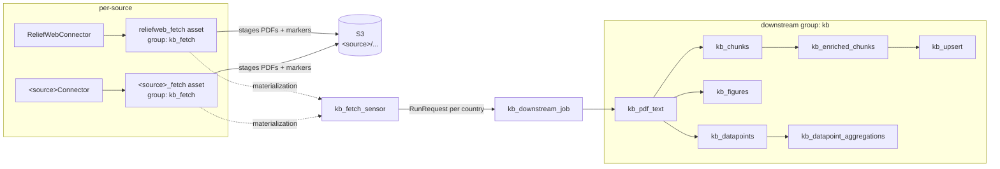

# Adding a knowledge-base source connector

How to plug a new PDF source into the knowledge-base (KB) pipeline. The pipeline
is **source-neutral**: every source stages PDFs + per-report metadata into its
own S3 namespace as a shared `KbRawDocument` contract, and one downstream turns
those into the knowledge base — vector chunks, figures, datapoints. Adding a
source means writing a small connector + a fetch asset + a schedule; the
downstream and the trigger are untouched.

See [ADR-0013](adr/0013-multi-source-knowledge-base-connectors.md) for the
design rationale.

## Architecture



Two kinds of source:

- **Pull** (ReliefWeb): a scheduled asset polls an API on a cadence. Most
  sources are pull.
- **Push** (manual upload): an external event (a user upload in clear-api)
  stages one document on demand — no schedule.

Both stage the same `KbRawDocument` shape to their own `<source>/…` S3 namespace,
and both trip the same `kb_fetch_sensor`, so both flow through the identical
downstream.

## The contract: `KbRawDocument`

`providers/kb_sources/base.py`. One staged PDF = one `KbRawDocument`. A report
with N attached PDFs produces N records sharing the report-level metadata.

| field | required | notes |
|---|---|---|
| `source` | ✅ | your connector's `key`, e.g. `"reliefweb"` |
| `report_id` | ✅ | stable, **source-namespaced** dedup id (ReliefWeb native id; `manual:<sha>` for uploads) → `(sourceId, externalId)` dedup downstream |
| `pdf_s3_key` | ✅ | where you staged the PDF (use the path builders below) |
| `title` | ✅ | report title |
| `published_at` | ✅ | ISO-8601 |
| `source_url` | | report/landing page URL |
| `publisher_name` / `publisher_homepage` | | resolved to a trusted `data_sources` row downstream |
| `country_iso3` | | lowercase iso3 — the Dagster partition key |
| `filename` | | attachment filename |
| `extra` | | free-form `dict` for source-specific bits |

Required fields are validated in `__post_init__` (blank → `ValueError`).

## S3 layout — the no-re-ingest guarantee

Use the **source-parameterized** builders in `providers/kb_sources/paths.py`
(never hand-build keys):

```
reports_prefix / pdf_prefix / pdf_key / text_prefix / chunks_prefix /
enriched_prefix / datapoints_prefix / figures_prefix  (source, iso3, format_slug)
```

Every key is namespaced under `<source>/…` and keeps the per-country `<iso3>/`
segment, e.g. `reliefweb/pdfs/sdn/situation-report/<report_id>/<file>`. Because
each source writes to its **own** keys and the downstream's skip-if-exists guards
key off S3 object presence, re-running a partition re-ingests **nothing** —
your source can never collide with another's.

> `test_kb_source_paths.py::test_reliefweb_paths_byte_identical_to_legacy` pins
> that `source="reliefweb"` reproduces the pre-refactor keys byte-for-byte. Add
> a similar parity test if you migrate an existing source.

## Add a PULL source

### 1. The connector — `providers/kb_sources/<source>.py`

Implement the `KbConnector` protocol (`key` + `fetch`), bind your `format_slug`
to the path builders, and register it. Model it on `reliefweb.py`:

```python
from clear_pipeline.providers.kb_sources import paths
from clear_pipeline.providers.kb_sources.base import KbRawDocument, register_connector

SOURCE = "acme"
FORMAT_SLUG = "sitrep"


class AcmeConnector:
    key = SOURCE
    format_slug = FORMAT_SLUG

    def pdf_key(self, iso3: str, report_id: str, filename: str) -> str:
        return paths.pdf_key(self.key, iso3, self.format_slug, report_id, filename)

    def fetch(self, *, country_iso3: str, window_start: str, window_end: str) -> list[KbRawDocument]:
        # 1. query your API for [window_start, window_end] for country_iso3
        # 2. for each attached PDF: stage to self.pdf_key(...), HEAD-skipping ones
        #    already in S3 (idempotent)
        # 3. return one KbRawDocument per staged PDF
        ...


register_connector(AcmeConnector())
```

`fetch` **stages the PDFs itself** (download → S3, skip if the key already
exists) and returns the records. Keep it idempotent: a re-run must re-stage
nothing.

### 2. The fetch asset — in `defs/`, group `kb_fetch`

A country-partitioned asset that computes the window, calls `fetch`, and writes
a first-ingest marker. Copy `reliefweb_fetch` in
[`reliefweb_to_s3.py`](../src/clear_pipeline/defs/reliefweb_to_s3.py):

```python
@dg.asset(group_name="kb_fetch", partitions_def=country_partitions)
def acme_fetch(context: dg.AssetExecutionContext) -> list[dict]:
    iso3 = context.partition_key
    # first ingest (empty reports prefix) -> 90d backfill; else 7d weekly delta
    ...
    docs = AcmeConnector().fetch(country_iso3=iso3, window_start=..., window_end=...)
    records = [asdict(d) for d in docs]
    # write a <week>.staged.jsonl marker under the source's reports prefix so the
    # NEXT run sees the country as established (weekly delta, not re-backfill)
    ...
    return records
```

- **Own group `kb_fetch`** so it is not pulled into another source's job and the
  downstream loads its output from storage.
- **Return `list[dict]`** (`dataclasses.asdict(doc)`) — the default IO manager
  must be able to serialize it.
- **Write the first-ingest marker.** `_is_first_ingest` keys off *any* object
  under the source's `reports_prefix`; without a marker every run re-runs the
  90-day backfill.

### 3. The schedule

One `@dg.schedule` per source, on its own cadence, fanning out one run per live
country partition. Copy `reliefweb_fetch_schedule`. Point it at a
`define_asset_job(selection=[acme_fetch])`. **Independent schedules** mean one
source's outage never blocks another.

### 4. Wire it into the trigger + downstream (the one coupling point)

Until the downstream input is fully generalized, two one-line edits in
[`reliefweb_to_s3.py`](../src/clear_pipeline/defs/reliefweb_to_s3.py) /
[`pdf_text.py`](../src/clear_pipeline/defs/knowledgebase/pdf_text.py):

1. Append your fetch asset's key to `_FETCH_ASSET_KEYS` so `kb_fetch_sensor`
   launches the downstream when your source stages data:
   ```python
   _FETCH_ASSET_KEYS = [dg.AssetKey("reliefweb_fetch"), dg.AssetKey("acme_fetch")]
   ```
2. Union your fetch output into `kb_pdf_text`'s staged docs (it currently takes
   `reliefweb_fetch` as a typed input; add yours and concatenate the lists).

Everything else in the downstream — `kb_chunks`, `kb_enriched_chunks`,
`kb_upsert`, `kb_figures`, `kb_datapoints`, `kb_datapoint_aggregations` — is
**source-agnostic and untouched**: it processes a `KbRawDocument` regardless of
origin and writes artifacts at the document's own `<source>/kb/…` path.

### 5. Tests

- Path parity / namespacing (mirror `test_kb_source_paths.py`).
- Connector `fetch` with the API + S3 mocked (mirror the ReliefWeb connector tests).
- The fetch asset: window selection (first-ingest vs weekly) + marker write
  (mirror `test_reliefweb_fetch_asset.py`).

## Add a PUSH source (e.g. manual upload)

A push source has **no `fetch` and no schedule** — an external event stages one
`KbRawDocument` on demand:

1. A `KbConnector` with only a `key` (e.g. `"manual"`) — `has_fetch()` returns
   `False`, so schedulers skip it.
2. The upload path (in clear-api) stages the PDF under `manual/…` and records a
   `KbRawDocument`.
3. The staging event trips `kb_fetch_sensor`, so the upload flows through the
   identical `kb_pdf_text → …` downstream.

Manual uploads keep the publisher marked trusted (reliability 4); `report_id` is
`manual:<sha>` so dedup stays source-namespaced.

## Invariants — do not break these

- **Per-source S3 namespace is the isolation boundary.** Never write outside
  `<source>/…`; never reuse another source's keys. This is what guarantees no
  cross-source collisions and no re-ingest.
- **No eager `AutoMaterializePolicy`** on the partitioned downstream assets. With
  fresh keys it could queue every partition. `kb_fetch_sensor` (cursor-tracked)
  is the controlled trigger.
- **The sensor processes only new batches** and never backfills history; the
  downstream's per-report skip-if-exists makes a replayed trigger a no-op.
- **`report_id` stays stable + source-namespaced** so `(sourceId, externalId)`
  dedup is unchanged across re-runs.

## Checklist

- [ ] `providers/kb_sources/<source>.py` — connector implemented + `register_connector`
- [ ] `<source>_fetch` asset in group `kb_fetch`, writes first-ingest marker (pull only)
- [ ] `<source>_fetch_schedule` on its own cadence (pull only)
- [ ] appended to `_FETCH_ASSET_KEYS` + unioned into `kb_pdf_text`
- [ ] tests: path parity, connector fetch, fetch asset
- [ ] `uv run pytest`, `uvx ruff check`, `dagster definitions validate -m clear_pipeline.definitions` all green
- [ ] dev: materialize `<source>_fetch` for one country → sensor launches `kb_downstream_job` → zero new artifacts for already-processed reports

## File map

| file | role |
|---|---|
| `providers/kb_sources/base.py` | `KbRawDocument`, `KbConnector`, registry |
| `providers/kb_sources/paths.py` | source-parameterized S3 key builders |
| `providers/kb_sources/reliefweb.py` | the reference pull connector |
| `defs/reliefweb_to_s3.py` | `reliefweb_fetch`, schedule, `kb_fetch_sensor`, `kb_downstream_job`, `_FETCH_ASSET_KEYS` |
| `defs/knowledgebase/pdf_text.py` → `datapoints_aggregate.py` | the source-neutral `kb_*` downstream |
