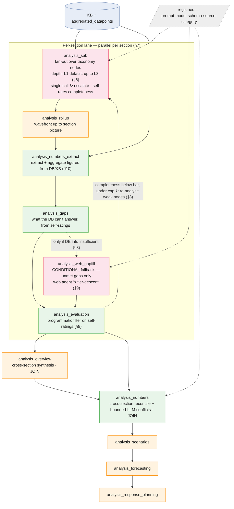
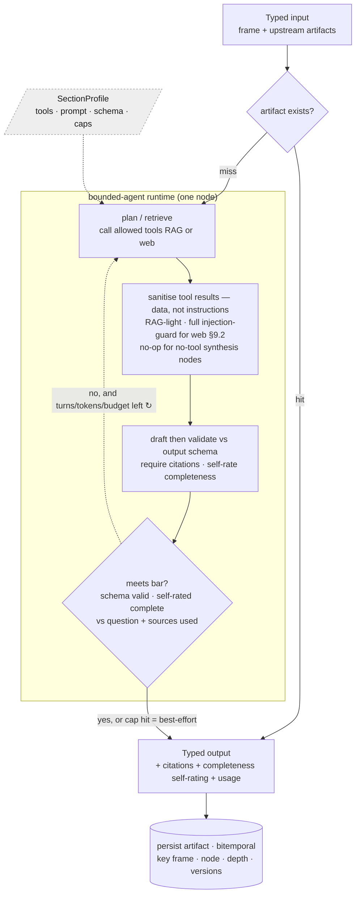
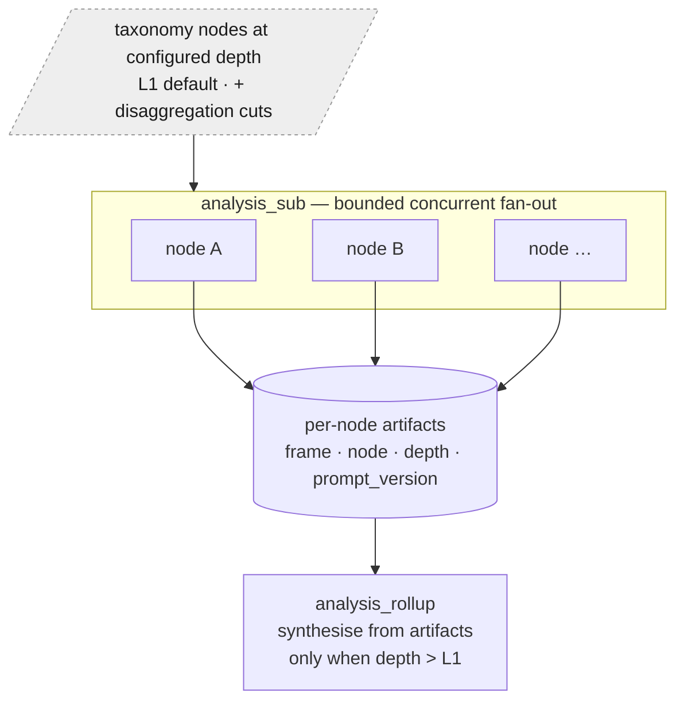
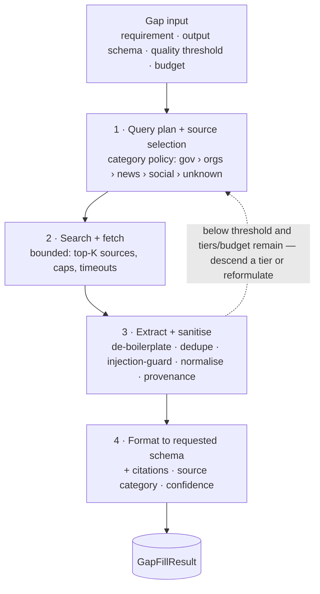

# Analysis module — agentic DAG architecture

> Companion to [`analysis-module-flow.md`](./analysis-module-flow.md) (the target flow) and the
> Exponential decision doc _"analysis generation orchestration — DAG of agentic actions vs
> agentic loop"_ (#1336). This realises the target flow as a **DAG of bounded-agent nodes on
> Dagster** — not a free agentic loop — so every stage stays addressable, re-runnable, budgeted,
> and auditable.
>
> Status: **draft for review.** Names are indicative; the shape is the proposal.

## 1. Principles

1. **DAG is the skeleton; agency lives inside nodes.** Orchestration (what runs, in what order,
   what re-runs) is explicit Dagster wiring. A node _may_ be a bounded agent, but no node owns the
   top-level control flow.
2. **Every stage is addressable + re-entrant** — run one stage alone; re-run from any earlier
   stage after a later one. The hard requirement from the flow owner ("move from step 4 to step 1,
   or execute only step 3"), native to Dagster assets.
3. **Bounded agency only.** Agent nodes have hard turn caps, a token/$ budget, and a tool
   allowlist. Adaptivity a free loop would give comes from **explicit, capped conditional edges**,
   never emergent control flow.
4. **Specialise by configuration, not by code.** Sections differ in tools/prompts/schemas/effort —
   that's declarative config on one shared agent runtime, not N hand-written agents (§4).
5. **Versioned + auditable.** Every artifact is stamped `(prompt_version, model, schema_version,
source_reliability)` + token usage, so trends stay comparable when wording/providers shift
   (extends the `generation_*_tokens` work on `analyses`).
6. **Frame-partitioned.** The unit of work is a `Frame` (country × window × sectors, ADR-0007),
   as today. Stages are partitioned by frame; re-runs and backfills are per-frame.

## 2. Module boundary

A **standalone `defs/analysis/` module**, separate from KB ingestion and from today's
`defs/situation` generator (which becomes the descriptive stage's seed — §15). It owns its own
asset groups, job(s), schedule, sensor, registries, and artifact layout.

## 3. Implementation DAG — the concrete nodes

Every box is a **Dagster asset** (frame-partitioned, materialisable on its own) — these _are_ the
DAG nodes. Colour marks the node kind; two assets contain a **bounded in-node loop**; one dashed
edge is the **capped cross-stage loop**. Per-node detail is in §5; the in-node loops are detailed
in §6 (node) and §9 (web); the cross-stage loop in §8.

**Legend** —

🟩 `det` deterministic code ·

🟧 `agent` shared agent runtime + a `SectionProfile`
(§4) ·

🟥 `aloop` agent node with a **bounded internal loop** ·

▢ external / config. `↻` = a loop.



**Where the agents and the loops are** (these three are the _only_ loops — all bounded):

- **Agent nodes** (shared runtime + a profile, §4): `analysis_sub` (analyst, RAG profile),
  `analysis_rollup` + `analysis_overview` (synthesis), `analysis_web_gapfill` (web profile).
  **Distinct-control-flow** agents (their own node, §4):
  `analysis_scenarios` / `_forecasting` / `_response_planning`.
- **Deterministic nodes:** `analysis_numbers_extract` (in-lane figure extraction + aggregation from
  DB/KB, bounded LLM only where parsing needs it), `analysis_gaps` (turns the analyst self-ratings
  into the list of questions the DB couldn't answer), `analysis_evaluation` (a **programmatic
  filter** over the self-ratings — no separate judge LLM, §8), and the core of `analysis_numbers`
  (cross-section reconciliation; a bounded LLM call _only_ to resolve conflicts).
- **Loops (all bounded + capped):**
  1. **In-node escalation** inside `analysis_sub` — a node failing a completeness/coverage check does
     extra retrieve→revise turns (§6).
  2. **Web tier-descent** inside `analysis_web_gapfill` — descend source _categories_ until answered
     or budget/tiers exhausted (§9).
  3. **Cross-stage re-analyse** — the dashed `analysis_evaluation ↻ analysis_sub` edge, capped at N
     iterations, per section (§8).
- **Conditional (not a loop):** `analysis_gaps ↻ analysis_web_gapfill` fires **only when the DB
  information is insufficient** — web gap-fill is a fallback, not a default stage (§8).
- **Fan-out / joins:** `analysis_sub` fans out concurrently over the taxonomy nodes at the
  configured depth (§7); the per-section lanes **join** at `analysis_overview` and
  `analysis_numbers`.

## 4. Execution model — one shared agent runtime + `SectionProfile`

Do **not** write a bespoke agent per section (or per node). Write **one bounded-agent runtime**
and specialise it per section with a declarative profile:

```
SectionProfile = {
  tools:          [rag] | [rag, web] | [numbers_tool, rag] | ...   # allowlist
  retrieval:      kb_only | web_first | hybrid
  prompt_id:      <registry ref>          # §12 prompt/model registry
  output_schema:  <versioned Pydantic>
  effort:         single_call | escalate_on_trigger | always_bounded
  depth:          L1 (default) | L2 | L3   # analysis depth (§6); run-level default, per-section override
  caps:           max_turns / max_tokens / max_usd
}
```

The runtime does: _"given these tools + this prompt + this schema + these caps, run the bounded
loop, enforce citations, record usage, stamp provenance."_ Tool heterogeneity ("web-heavy",
"RAG-heavy", "needs tool X") is a **profile field**, not a fork.

- **Promote a section to a distinct node only when its _control flow_ differs** — a real
  multi-step algorithm the generic engine can't express. The test: differs only in
  `{tools, prompt, schema, retrieval, effort}` → profile; the engine needs to know _which section
  it is_ (imperative `if section == X`) → split into its own node.
- Distinct nodes are precisely the already-separate stages with structurally different reasoning:
  **further-analyses** (`scenarios`/`forecasting`/`response_planning`) and the **numbers
  reconciler**. Descriptive sections and roll-up are shared-engine + profile; **gaps, evaluation,
  and numbers extraction are deterministic** (no agent) — evaluation in particular is a programmatic
  filter over the analysts' own completeness self-ratings (§8), not a judge LLM.

### How a single node executes

The inside of one agent node — the generic path the runtime runs for every `agent`/`aloop` box:



Read it as:

- **Skip-if-exists first** — a cached artifact for this `(frame, [node], depth, versions)`
  short-circuits to the stored output (this is what makes re-runs cheap and per-node re-runs
  granular, §13).
- **One pass by default; the `↻` is the only loop** — `single_call` profiles never take the back
  edge; `escalate_on_trigger` / `always_bounded` take it until the bar is met or a cap
  (turns / tokens / $) trips, then emit **best-effort** output flagged with a low completeness
  self-rating. The in-node escalation (§6) and web tier-descent (§9) _are_ this edge with
  node-specific bars/tools.
- **Tool results are sanitised before use, scaling with the tool** — all retrieved content is
  treated as data, never instructions. KB/RAG results get a light normalise; **web results get the
  full injection-guard + boilerplate/dedupe/normalise** (§9.2), which matters because web gap-fill
  is the conditional, adversarial path (§8). No-tool synthesis nodes have nothing to sanitise.
- **Output is validated against the versioned schema, carries citations + usage, and is stamped**
  with `(prompt_version, model, schema_version)` before it's persisted (§11, §12). It also carries a
  **completeness self-rating** — the node scoring how fully it answered its analysis question given
  the sources it actually used. That rating is what `analysis_gaps` and `analysis_evaluation`
  consume; there is no separate adversarial/judge pass (§8).
- **Deterministic nodes** (`analysis_numbers_extract`, `analysis_gaps`, `analysis_evaluation`, and
  the `analysis_numbers` reconcile core) skip the `run` loop entirely — straight input → code →
  persist.

## 5. Node catalogue

| Node (asset)                                                 | Realisation                                                                                                                | Consumes                                                | Tools / caps                                      | Produces                                              |
| ------------------------------------------------------------ | -------------------------------------------------------------------------------------------------------------------------- | ------------------------------------------------------- | ------------------------------------------------- | ----------------------------------------------------- |
| `analysis_sub`                                               | shared **analyst**, fanned out per taxonomy node at the configured depth (**L1 default**, up to L3); **single call by default, escalates to a bounded loop on a trigger** (§6) | KB + datapoints, registry, disagg cfg                   | RAG; escalation adds re-retrieve/self-check turns | per-node findings + citations + **completeness self-rating** |
| `analysis_rollup`                                            | shared engine (synthesis profile), **wavefront** up to section picture (only when depth > L1)                              | the section's node artifacts (NOT fresh RAG)            | synthesis only; ≤1–2 turns                        | subpillar → pillar → **section** picture              |
| `analysis_numbers_extract`                                   | **in-lane, deterministic** — extract + aggregate figures from DB/KB + node findings (bounded LLM only where parsing needs it) (§10) | node findings + aggregated_datapoints                   | numbers tool; no web                              | per-section figures + per-number provenance (pre-gap)  |
| `analysis_gaps`                                              | deterministic — reads the self-ratings + extracted numbers, lists the questions the DB **couldn't** answer                 | node + roll-up self-ratings, extracted numbers          | —                                                 | ranked unmet-information gaps (per section)            |
| `analysis_web_gapfill`                                       | **bounded agent, web profile — CONDITIONAL** (only runs for unmet gaps; not a default stage) (§9)                          | unmet gaps only (per-section budget)                    | web search/fetch; capped queries + $              | external evidence, tiered + cited                     |
| `analysis_evaluation`                                        | **deterministic programmatic filter** over the self-ratings (no judge LLM) — drops/flags low-completeness outputs (§8)      | descriptive + (optional) gap-filled package + self-ratings | —                                              | filtered package + per-section completeness summary    |
| `analysis_overview`                                          | shared engine (synthesis profile); **cross-section JOIN**                                                                  | all sections' roll-ups                                  | synthesis only                                    | cross-cutting descriptive picture                     |
| `analysis_numbers`                                           | **distinct node** — **cross-section** reconcile + bounded LLM for conflicts                                                | filtered package + per-section extracted numbers + web numbers | —                                          | final figures + per-number provenance                 |
| `analysis_scenarios` / `_forecasting` / `_response_planning` | **distinct nodes** (own control flow), bounded                                                                             | evaluated package + final numbers                       | per-stage tools                                   | the further-analysis products                         |

## 6. Descriptive — depth-configurable node fan-out + tiered effort

The **unit of work is a taxonomy node at the configured analysis depth** — **L1 (pillar) by
default**, descending to L2/L3 only when a run (or a section's profile) asks for it. All depths
share **one parameterised analyst** — not a bespoke agent each. ("Leaf" below = the deepest node at
the active depth.)



- **Analysis depth (configurable, default L1):** by default only **L1 pillars** are analysed — one
  analyst call per L1 node, no roll-up needed. A run opts into deeper analysis (`depth=L2` /
  `depth=L3`) globally or per section via the profile (§4); deeper depths fan out more nodes and
  turn on the wavefront roll-up (§7). L1-default caps cost for the common case; L3 is on-demand.
- **Sequencing (depth > L1):** deepest nodes first; roll-up **synthesises from those artifacts**,
  never a blank RAG call. At `depth=L1` there is nothing to roll up — the L1 node artifact _is_ the
  section picture.
- **Addressing:** each node writes a content-addressed artifact keyed
  `(frame, node, depth, prompt_version, schema_version)`; a `skip-if-exists` guard (the KB idiom)
  means **re-running one node recomputes only that node**.
- **Tiered effort (cost control):** a node is a **single structured RAG call by default**, and
  **escalates to a bounded loop** (re-retrieve → self-check → revise) only on a cheap trigger —
  low self-rated completeness, required questions unanswered, thin/empty retrieval, or a cited-
  number conflict. Single-shot for the many; bounded loop for the few that need it.
- **Disaggregations (geo/age/gender/group/topic)** parameterise the analyst via the profile —
  a new cut is a config entry, never a fork.
- **Cost levers if needed:** at deeper depths, batch sibling nodes under one parent into a single
  call (shared evidence); run nodes on a cheaper model, roll-up on the stronger one. Tunables, not
  rewrites.

## 7. Concurrency, per-section lanes & join points

Parallelism is **partial-order**, bounded by the dependency shape, the executor, and rate
limits/budget.

**What parallelizes**

- **All taxonomy nodes at the analysis depth (L1 by default) are independent across all sections**
  → bounded concurrent fan-out (the main throughput lever). Deeper depths fan out more nodes.
- **Roll-up is wavefront (only when depth > L1):** L2 after its nodes, L1 after its L2s, section
  picture last. At `depth=L1` the fan-out _is_ the section set — no roll-up wavefront.
- **Descriptive → numbers-extract → gaps → (conditional gap-fill) → evaluation runs as parallel
  per-section lanes** — a section races through its own evaluation (and its own per-section
  re-analyse loop) while another is still drafting. No per-stage global barrier.

**Where lanes must reconverge (joins)**

1. **Overall cross-cutting synthesis** — joins the section roll-ups.
2. **Numbers reconciliation** — global: the same figure cited by multiple sections must be
   _consistent_, so reconcile needs all sections. **Per-section extraction + aggregation stays
   in-lane and happens early (before the gap decision, §10); the cross-section reconcile is the
   join.**
3. **Further analyses** — reason over the whole evaluated package + final numbers.

So lanes run parallel through evaluation, **join before the numbers reconcile**, then
further-analyses run once. Numbers are extracted + aggregated in-lane first; **web gap-fill fires
only for the gaps the DB couldn't answer** (conditional, under a per-section budget — §8); the
re-analyse loop localises to the weak section (cheaper + more parallel).

**Executor reality.** The pipeline runs Dagster's **`in_process` executor** (chosen to halve
per-run memory). In-process = steps run sequentially within a run, so:

- Realise the fan-out as **concurrent calls _inside_ the stage asset** (thread pool / asyncio over
  nodes/sections) — like `kb_pdf_text`'s in-asset `ProcessPoolExecutor` — **not** as parallel
  Dagster steps. Stage boundaries are the natural join points.
- **Cap concurrency** (a semaphore / `max_workers`, ~4–8 in flight) to respect provider RPM/TPM,
  `EMBEDDING_RPM_LIMIT`, clear-api RAG load, and the run budget. Parallel ≠ unbounded spend.
- Only split sections into separate Dagster **runs + a fan-in sensor before numbers** if
  head-of-line blocking at a stage barrier is _measured_ — don't build it speculatively.

**Usage accounting under concurrency.** Concurrent nodes sharing one provider instance race the
`total_usage` accumulator (and make `last_usage` meaningless). Use **one provider instance per
concurrent unit and sum their totals** (also isolates fallback state), or guard accumulation with a
lock.

**Frame level.** Separate frames (countries) parallelize as separate Dagster runs, already throttled
by the `clear/weight: heavy` queue limit.

## 8. Numbers-first, conditional gap-fill, self-rated evaluation (bounded, per-section)

The order matters: **know what the DB already answers before spending anything on the web.**

1. **Extract + aggregate numbers first** (`analysis_numbers_extract`, §10) — pull and aggregate the
   figures the DB/KB already hold for the section, in-lane, before any gap decision.
2. **Identify unmet gaps** (`analysis_gaps`) — deterministically turn the analysts' **completeness
   self-ratings** (plus required-question coverage and the extracted numbers) into a ranked list of
   the questions the DB **couldn't** answer. Foreshadowed by `completeness` /
   `questions_not_answered` in the situation schemas.
3. **Gap-fill is CONDITIONAL, not the norm** (`analysis_web_gapfill`, §9) — it runs **only for the
   unmet gaps**, under a per-section query + $ budget. When the DB already answered the section's
   questions (the common case), **web gap-fill is skipped entirely** — no cost, no latency.
4. **Evaluation is a programmatic filter, not an adversarial judge** (`analysis_evaluation`) — there
   is **no separate judge/critic LLM**. Each node has already **self-rated how completely it answered
   its analysis question given the sources it used**; evaluation then **filters/flags
   programmatically** — e.g. drop or mark outputs below a completeness threshold, below a
   source-reliability floor, or with unresolved cited-number conflicts. Thresholds are config, so the
   filtering policy changes without a model call.
5. **Cross-stage re-analyse (conditional edge, not a loop):** if a section's filtered completeness is
   below bar **and** `iteration < N` (e.g. N=1) **and** budget remains, re-materialise **only the weak
   nodes** for that section, then roll-up → re-filter. Otherwise proceed. Cap + budget make it
   terminating; each iteration is its own Dagster run.

## 9. Web gap-fill agent

A **bounded sub-pipeline**, one run per gap, inside the per-section `analysis_web_gapfill` node.
**It runs only for the unmet gaps the DB couldn't answer (§8) — not on every run.**



### 9.1 Source ranking — rank _categories_, classify sources at runtime

**Do not maintain an exhaustive source allowlist** — it would rot, never achieve coverage, and
become the bottleneck/limitation. Instead:

- **Rank a small fixed set of categories** (stable, the only thing hand-maintained):

  | Category                      | Reliability (maps to `data_sources.reliability`) | Examples                                                       |
  | ----------------------------- | ------------------------------------------------ | -------------------------------------------------------------- |
  | 1 · Government / official     | highest (≈4)                                     | national stats offices, ministries; UN (OCHA, UNHCR, IOM, WHO) |
  | 2 · Reputed organisations     | high (≈3)                                        | established NGOs, research institutes, ReliefWeb-class         |
  | 3 · Reputable news            | medium (≈2)                                      | established outlets                                            |
  | 4 · Reputable social accounts | low–medium                                       | verified official orgs / officials                             |
  | 5 · Other / unknown           | lowest                                           | everything unclassified                                        |

- **Classify each encountered source into a category at runtime** — don't enumerate sources:
  - cheap signals first: TLD/domain heuristics (`.gov`, `.int`, UN domain family, `.edu`), known
    high-tier _anchors_ (a tiny seed, not a master list), publisher metadata;
  - an **LLM classification** call for the long tail (domain + page context → category + rationale);
  - optionally **cache** each resolved `(domain → category)` so it's classified once — a cache that
    grows by observation, explicitly **not** a hand-curated registry.
- **Align with the existing trust scale:** the category maps onto `data_sources.reliability`
  (manual uploads already get the trusted value) so web, KB, and manual evidence share one
  comparable reliability number.
- **User-specified websites (future):** leave room for an operator-maintained list of sites to
  prefer (or require), each **pinned to a category** — treated as high-tier anchors that the query
  planner tries first and the classifier trusts without re-deriving. It's additive config layered
  _over_ the runtime classifier (not a replacement for it), so the default stays zero-maintenance
  while a user who knows the authoritative source for a country/sector can steer gap-fill to it.
  Not built in v1; the category policy + `(domain → category)` cache (§12) is the natural seam.

### 9.2 Loop, sanitisation, output

- **Bounded tier descent:** try the highest category that could answer; if below the quality
  threshold _and_ tiers/budget remain, descend a category or reformulate — capped on categories
  tried, queries/fetches, tokens/$, wall-clock. Terminate on answered-at-quality, tiers exhausted,
  or cap hit (→ best-effort + low confidence + `unresolved`). Never an open loop.
- **Injection defense (critical):** fetched web content is untrusted and adversarial. The extractor
  treats fetched content strictly as **data, never instructions**; sanitisation neutralises embedded
  directives, strips boilerplate/ads, de-dupes, normalises units/dates, and attaches provenance
  (URL + category + retrieval timestamp + the exact query) to every claim.
- **Caching + politeness:** cache fetched pages keyed `(url, date)`; respect robots/ToS.
- **Output contract:**
  ```
  GapFillResult = {
    gap_id, requirement,
    value,                 # in the requested format/schema
    sources: [{url, category, reliability, title, retrieved_at, quote}],
    source_category_used,  # highest category that actually answered
    confidence, status,    # resolved | partial | unresolved
    usage, provenance,     # tokens/$, (prompt_version, model)
  }
  ```
- **The category rides downstream:** because `source_category_used`/reliability travels with the
  evidence, **evaluation** and **numbers reconciliation** discount low-category web data against
  KB/official sources in a conflict (a Tier-1 gov figure outranks a Tier-4 social one). That's what
  makes the ranking matter rather than decorate.

## 10. Numbers, further analyses, later sections

- **`analysis_numbers_extract` (in-lane, early — before the gap decision):** deterministically
  extract the figures relevant to the section from KB / `aggregated_datapoints` + the node findings
  and **aggregate** them (sum / latest-per-pcode, the same shape as the DTM aggregation), carrying
  per-number provenance. This runs **before** gaps / gap-fill, so the pipeline knows what the DB
  already answers and only reaches for the web when a number is genuinely missing (§8). A bounded LLM
  call is used only where a figure must be parsed out of prose.
- **`analysis_numbers` (cross-section reconcile — distinct JOIN node):** reconcile the per-section
  extracted figures against each other (+ any web numbers from conditional gap-fill), with a bounded
  LLM call _only_ for conflicts. Produces final figures **with per-number provenance** — the single
  source of truth for products and dashboards.
- **Further analyses (stage 3):** `scenarios → forecasting → response_planning`, each a distinct
  node consuming the **evaluated package + final numbers**, never raw KB. Independently runnable.
- **Later / independent sections** (market analysis, vulnerabilities, …) are **pluggable stages**
  attaching to the evaluated package; out of the critical path, added over time without touching the
  core.

## 11. Bounded-agent node contract

Every agent node conforms to one contract, so nodes stay swappable + testable:

- **Typed input** (frame + upstream artifacts), **typed output** (versioned Pydantic schema).
- **Tool allowlist** from the `SectionProfile` (RAG-only for sub; web for gap-fill). Gaps,
  evaluation, and numbers-extract are deterministic nodes, not agents, so they sit outside this
  contract.
- **Hard caps:** max turns, max tokens, per-node $ budget; a run-level budget guardrail aborts
  further spend (extends `providers/guardrails.py` — present but currently unwired).
- **Citations required** for any asserted finding (`[Rn]` → report ids, as today).
- **Usage recorded** per node (input/output tokens → run cost), the per-node analogue of the
  `generation_*_tokens` on `analyses`.
- **Provenance stamp** `(prompt_id, prompt_version, model, schema_version)` on every artifact.
- **Unit-testable** with fixed inputs + a mocked provider (as the situation components are today) —
  the DAG never needs end-to-end trajectory tests to cover a node.

## 12. Registries & versioning

- **Prompt + model registry:** `(prompt_id, prompt_version, model)` per node, versioned over time;
  every artifact stamped so results stay auditable when wording/providers change (§1.3 of the flow).
- **Schema registry:** versioned output schemas; bumping re-keys artifacts (versions coexist, trend
  reads never mix them).
- **Source-category policy:** the fixed 5-category ranking + the runtime classifier + the observed
  `(domain → category)` cache (§9.1) — categories hand-maintained, sources never. The future
  operator-maintained **pinned-sites list** (§9.1) layers on here: user-specified domains mapped to a
  category, merged ahead of the classifier.

## 13. State, artifacts, idempotency

- Each stage persists to **S3 (intermediate)** and **clear-api (published)**, keyed
  `(frame, stage, [node], depth, prompt_version, schema_version)`.
- **Skip-if-exists** on those keys gives cheap re-runs and the per-node granularity (§6).
- Published analyses stay **bitemporal** (supersede + insert), as `upsert_analysis` is today.
- Web fetches cached `(url, date)` (§9.2).

## 14. Dagster realisation + layout

```
src/clear_pipeline/defs/analysis/
  __init__.py
  frame.py                # reuse / extend ADR-0007 Frame (partitioning)
  runtime.py              # the ONE bounded-agent runtime (§4) + caps/citations/usage
  profiles.py             # SectionProfile definitions per section (§4)
  registry.py             # prompt + model + schema versions (§12)
  taxonomy.py             # L1/L2/L3 nodes (depth-configurable, L1 default) + disaggregation cuts
  sources.py              # category policy + runtime classifier + (domain→category) cache + pinned sites (§9.1)
  artifacts.py            # S3/clear-api keys + skip-if-exists (§13)
  web_agent.py            # the web gap-fill sub-pipeline (§9) — invoked only for unmet gaps
  assets_descriptive.py   # analysis_sub (concurrent fan-out) + analysis_rollup (depth > L1)
  assets_gaps.py          # analysis_gaps, analysis_web_gapfill (conditional), analysis_evaluation (programmatic filter)
  assets_numbers.py       # analysis_numbers_extract (in-lane, pre-gap) + analysis_numbers (cross-section reconcile)
  assets_further.py       # scenarios / forecasting / response_planning
  jobs.py schedules.py sensors.py
```

- **Groups** `analysis_descriptive` / `_eval` / `_numbers` / `_further` so a job can select a stage
  or the whole module (mirrors `kb_downstream_job`). **Executor:** `in_process`.
- **Trigger:** a schedule per cadence + optional sensor off a frame's KB/datapoints refresh, gated
  by the 24h floor already in `upsert_analysis`.

### Re-entry — the modularity requirement, concretely

| Want                                          | How (Dagster)                                                                                   |
| --------------------------------------------- | ----------------------------------------------------------------------------------------------- |
| Run only evaluation (step 3)                  | materialise `analysis_evaluation` for the frame — upstream loaded from storage                  |
| Re-run from descriptive after numbers (4 → 1) | asset-select `analysis_sub+` (descriptive → downstream) for the frame                           |
| Re-run one taxonomy node                      | invalidate that node's artifact; re-materialise `analysis_sub` (skip-if-exists reuses the rest) |
| Deepen one section to L2/L3                   | set `depth` on that section's profile; re-materialise its descriptive lane (new depth re-keys artifacts, L1 stays cached) |
| Re-run one section's lane                     | materialise that section's descriptive→evaluation assets; numbers re-joins                      |
| Backfill a new country                        | add its `Frame` partition; materialise the module for it                                        |
| Bump a prompt/model                           | new `prompt_version` → artifacts re-key → affected nodes recompute, old versions preserved      |

## 15. Migration from `defs/situation`

Incremental — not a rewrite:

1. Stand up `defs/analysis/` with the stage skeleton + runtime + registries + artifact layer; the
   descriptive stage first calls the **existing** situation component functions as its **L1 nodes**
   (the default depth) — no roll-up needed until a section opts into L2/L3.
2. Map current components: `ai_summary / context_risks / hazards / displacement /
humanitarian_access / sectors` → descriptive **L1 nodes**; `scenarios` → a stage-3 node (now on the
   _evaluated_ package, not a sibling); `changes` → a cross-stage concern.
3. Add the genuinely new stages in dependency order — `numbers_extract` (in-lane, pre-gap) → `gaps`
   → conditional `web_gapfill` → `evaluation` (programmatic filter) → `numbers` (cross-section
   reconcile) — one at a time, each shippable + evaluable on its own.
4. Retire the monolithic `weekly_situation_analyses` asset at parity.

## 16. Open questions

- Node fan-out: op-level in-asset concurrency (proposed) vs per-node Dagster partitions (native
  "materialise one node" but a frames×nodes partition explosion). Recommend the former.
- Analysis depth: is L1 the right universal default, or should some sections default deeper? How is
  `depth` surfaced to the requester (run config, per-section profile, or a product-level setting)?
- Evaluation: the completeness self-rating + programmatic filter replaces an LLM judge — what are
  the filter thresholds (completeness floor, source-reliability floor), and do we still want an
  offline eval harness later to calibrate them? Re-analyse iteration cap `N`.
- Gap-fill trigger: what exactly counts as "DB info insufficient" to fire conditional web gap-fill —
  a required-question-unanswered flag, a completeness floor, a missing-number flag, or a mix?
- Source classifier: heuristics + LLM confidence thresholds; how aggressively to trust the
  `(domain → category)` cache vs re-classify; and when to add the operator **pinned-sites** list
  (§9.1) — per-frame, per-sector, or global.
- Where final numbers live (same `analyses` row + a numbers artifact, or a dedicated store), and
  whether per-section extracted numbers persist separately from the cross-section reconcile.
- Budget policy: per-frame vs per-run caps; behaviour when a frame exhausts budget mid-stage (ship
  evaluated-so-far vs fail).
