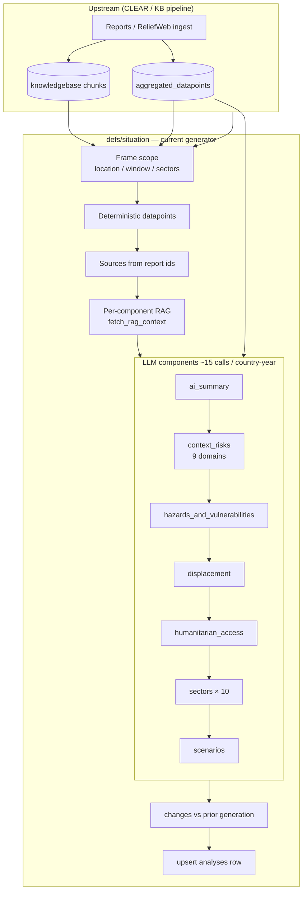
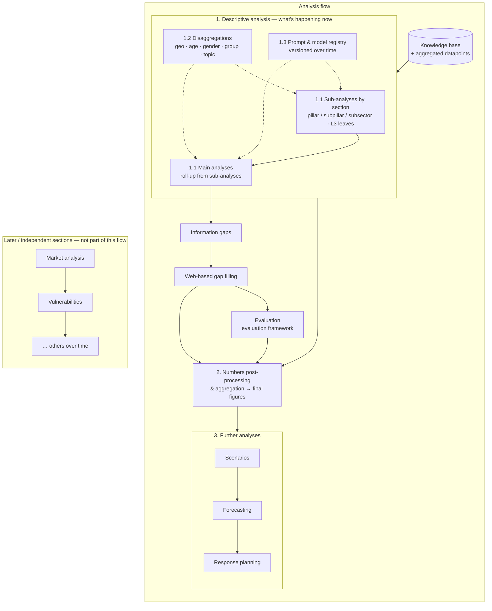
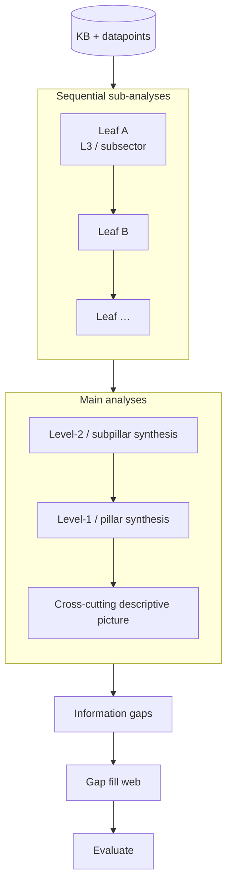
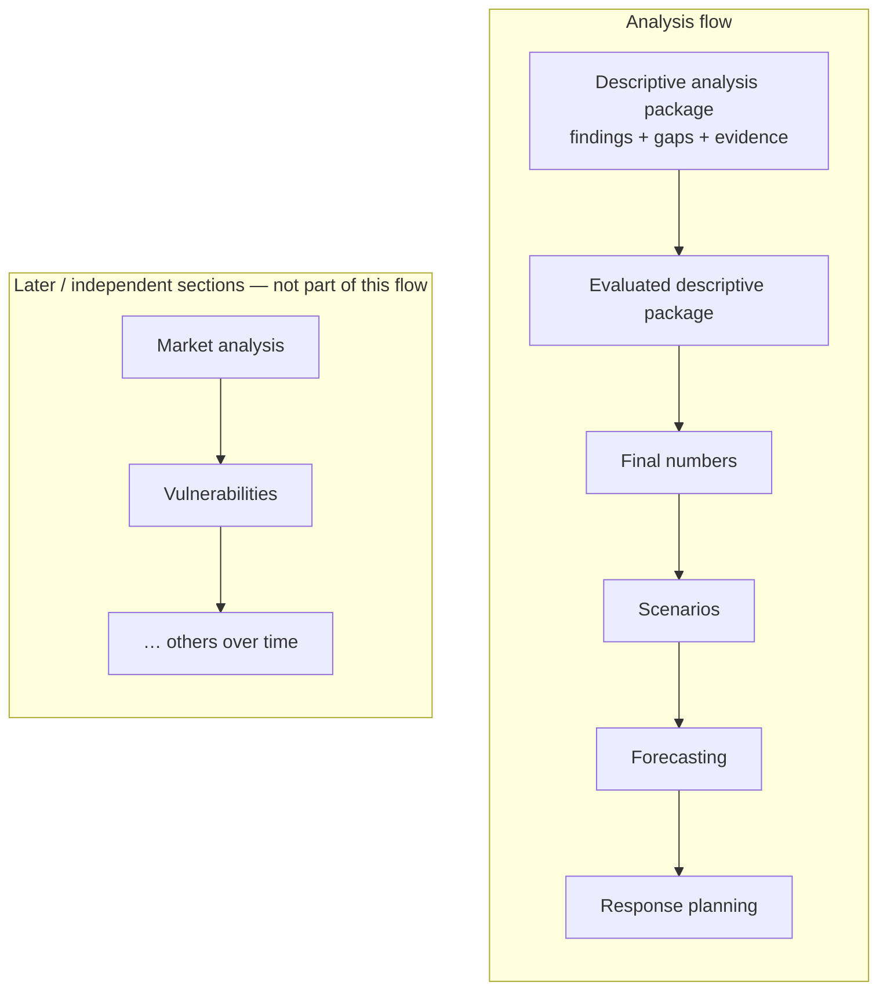

# Analysis module steps

# Analysis module — overall flow

**Objective:** justify a **standalone analysis module**, separate from the knowledge-base / ingestion pipeline. Today, situation narrative lives inside `clear-context-pipeline` (`defs/situation`). The target flow is richer: sequential descriptive analysis by taxonomy leaf, gap filling, evaluation, number aggregation, and downstream analytical products — too large and too changeable to remain a side package of KB ingestion.

---

## 1. Current flow (as implemented)

Source: `NRC/CLEAR/clear-context-pipeline/src/clear_pipeline/defs/situation`

Today’s weekly situation analysis is a **downstream Dagster asset** of KB + aggregated datapoints. It builds one snapshot per frame (typically country × window), then runs a handful of **parallel-style LLM components** (each with its own RAG), plus deterministic datapoints/sources.

### What this flow does well

- Grounds narrative in KB via RAG + citations (`[Rn]` → report ids).
- Isolates failures per component; can ship deterministic-only via `SITUATION_SKIP_NARRATIVE`.
- Uses first-level analysis questions from CSV as RAG/prompt source of truth.
- Already generalises scope via `Frame` (ADR-0007).

### What this flow does **not** do (gap vs target)

- No **sequential leaf → roll-up** along the full taxonomy (L1 / L2 / L3).
- No explicit **information-gap** object, then **web-based gap filling**.
- No structured **evaluation** pass against the evaluation framework.
- No dedicated **numbers post-processing / final aggregation** beyond hoisting aggregated datapoints.
- Scenarios (and future products) are **siblings** of descriptive components, not a second stage that consumes a finished descriptive analysis.
- Disaggregations and prompt/model evolution are not first-class module concerns.

---

## 2. Target flow — standalone analysis module

### 2.1 End-to-end

### 2.2 Descriptive analysis detail (1 / 1.1)

Descriptive analysis answers **what is happening currently**. It is the core product of the module and the input to everything else.

**1.1 Sequencing rule**

1. Run many **sub-analyses** by section (pillar → subpillar → subsector / taxonomy leaf).
2. Only then run **main analyses** that synthesise from those sub-analyses (do not invent the roll-up from a fresh blank RAG call alone).

**1.2 Disaggregations** (extensible over time)

| Dimension      | Examples                                            |
| -------------- | --------------------------------------------------- |
| Geolocation    | Admin0 → Admin1 → Admin2, camps, corridors          |
| Age group      | Children, adults, older persons                     |
| Gender         | Women, men, mixed HHs                               |
| Specific group | IDPs, returnees, host, persons with disabilities, … |
| Topic          | Cross-cutting themes beyond sector taxonomy         |

Disaggregations are **additive configuration**: new cuts can be introduced without rewriting the whole pipeline.

**1.3 Prompts and models**

- Prompts and model choice may change over time for narrative quality and consistency.
- The analysis module should own a **versioned registry** (prompt id + model + schema version) so results remain auditable when wording or providers shift.

### 2.3 After descriptive analysis

| Stage                          | Role                                                                                                                                                                          |
| ------------------------------ | ----------------------------------------------------------------------------------------------------------------------------------------------------------------------------- |
| **Information gaps**           | Explicit list of unanswered / weakly supported questions from sub- and main analyses (`completeness`, `questions_not_answered` already foreshadow this in situation schemas). |
| **Web-based gap filling**      | Targeted retrieval outside the local KB to close high-priority gaps; re-attach evidence and citations.                                                                        |
| **Evaluation**                 | Score / review descriptive (+ gap-filled) outputs against the **evaluation framework** before treating them as trusted inputs.                                                |
| **2. Numbers post-processing** | Reconcile LLM-extracted and KB-aggregated figures; produce **final numbers** for products and dashboards.                                                                     |
| **3. Further analyses**        | Scenarios, forecasting, response planning — each consumes the evaluated descriptive picture (+ final numbers), not raw KB alone.                                              |

**Later / independent sections** (separate from the analysis flow above): market analysis, vulnerabilities (needed for scenarios), and other sections to be built later; more can be added over time.
