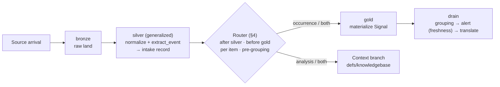
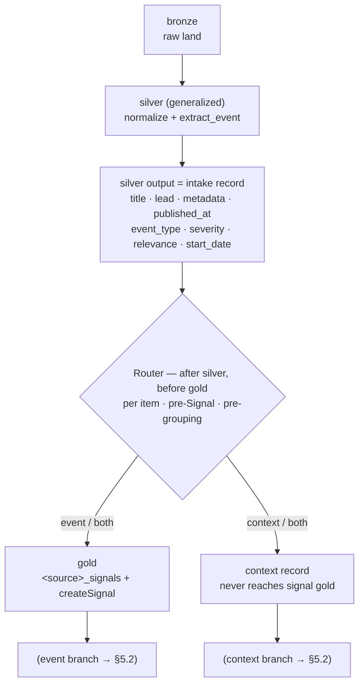
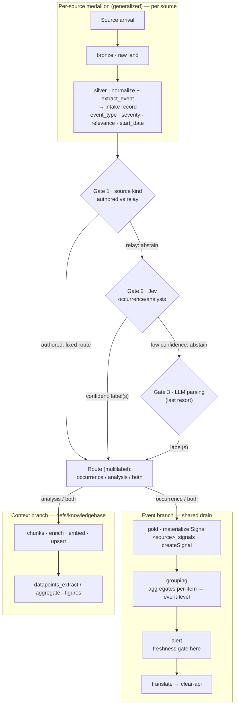

# Unified ingestion router — V0 architecture

**Status:** V0 / proposal — a first architecture sketch to react to, not an
approved design. Nothing here is settled; every choice below is a candidate to
challenge, revise, or drop. Not yet ticketed, not built.

**Scope:** A single ingestion entrypoint that would route heterogeneous incoming
content to the **event** pipeline (`defs/signals`), the **context** pipeline
(`defs/knowledgebase`), or **both**, parsing each item once.

Companion reading: `data-quality-medallion-implementation.md` (the signals
medallion as built), `data-quality-ingestion-design.md` (signals ingest
quality), `adding-a-kb-source-connector.md` (the context path).

**Terminology.** Following team convention, a **signal** is *any raw item that
enters the bronze stage* — a ReliefWeb PDF, an X post, an ACLED row — whatever its
source or format, and before we know whether it is an occurrence or analysis. It is
the type-agnostic **unit of ingestion** (the **intake record**). This is deliberately distinct from a
**clear-api Signal** (capital S): the materialized event-pipeline object that
`createSignal` writes, backed by the `<source>_signals` gold table and
`create_signal_for_sync`. The crux of this design is that the two must not be
conflated — today the medallion turns a raw signal straight into a clear-api Signal,
committing it to the event pipeline before anything routes (§5.1).

---

## 1. Problem

The sources we integrate are not homogeneous on two independent axes:

1. **Format heterogeneity** — an arrival can be a short alert (Dataminr), a
   structured dataset row (ACLED, IDMC), a social post, or a multi-page PDF
   report.
2. **Type heterogeneity** — the *same* arrival can be an **occurrence** (a
   discrete, locatable event) or **analysis** (the analytics / background *around*
   an occurrence — cumulative statistics, situation analysis) — and sometimes both.
   This is a judgement about **content shape, not recency**: an occurrence is still
   an occurrence whether it happened today or last year. Recency decides only
   whether the occurrence raises an *alert*, never whether it belongs in the events
   table.

Today the destination is implicit in *which connector* ingested the item. That
fails both axes: a connector can legitimately carry both events and context, and
the right destination depends on the **content**, not only its origin. We also
re-parse the same bytes when an item must reach both paths.

**What V0 aims for:**

- **One entrypoint** that decides event / context / both per item.
- **Parse once, reuse** — a single parse pass feeds whichever path(s) consume the
  item.
- **Cheap decisions on a bounded surface** — a fast Jev classifier makes the
  occurrence / analysis call, with an LLM held in reserve only for what Jev cannot
  confidently resolve.

---

## 2. Shape of the design

Each source runs its **own medallion** (bronze → silver → gold) that does all
source-specific work **per item** — parse / normalize plus `extract_event`, which
stamps `event_type`, `severity`, `relevance`, and `start_date` (+ accuracy). A
**shared drain** then does **event grouping** — clustering members and
*aggregating* their per-item attributes into event-level type/severity — then
alert and translate.

**But the medallion immediately materializes every signal as a clear-api Signal**
(§5.1): silver emits `signal_input` records, gold is a `gold.<source>_signals`
Iceberg table, and `_push` calls `create_signal_for_sync`. The type judgement is
baked in at ingest, before anything routes — the thing coming out of the medallion
is *already* a clear-api Signal. So the router cannot simply sit "after the
medallion."

V0 therefore **generalizes** the shared part: the absorb + extract work
(bronze → silver → `extract_event`) becomes an **intake record** usable
by either pipeline, and the **Signal materialization** (signals-gold +
`create_signal_for_sync`) moves onto the **event branch**, after routing. The
router forks on that intake record — per item, *after* classification, *before*
the Signal is made, and *before* grouping aggregates it.

---

## 3. Absorption — the per-source medallion (generalized)

Most of this stage already exists; the change is to make its output
**type-agnostic**. Today each source's medallion runs `parse` → `project` →
`SignalView` and `extract_event`, but it emits a **clear-api Signal** the whole way:
`signal_input` at silver, a `<source>_signals` table at gold (§5.1). V0 keeps the
absorb + extract work and stops it one step short of the Signal, yielding a
**intake record**:

- **title · lead · metadata · `published_at`** (the normalized fields), plus
- the per-item `extract_event` output (`event_type`, `severity`, `relevance`,
  `start_date` + accuracy, geolocation).

This record is the router's input surface and the single parse/classify artifact
both branches reuse:

- **The router decides from a bounded surface** — title + lead + metadata + the
  extraction, *never the full document*. This keeps a 15-page report from being
  read in full just to be routed. (Format length is deliberately **not** a routing
  signal — the earlier "PDF > N pages → context" idea is set aside; size is a weak
  proxy for event-vs-context.)
- **Classification is cheap and multilabel.** A fast Jev classifier makes the
  occurrence / analysis call on this surface (§4.2); only what it cannot resolve
  reaches the LLM (§4.3). When an item is labelled `both`, the same intake record
  feeds both branches — no re-parse, no re-extract.

**Reports are absorbed too, by a different adapter.** ReliefWeb reports do not run
the signal medallion, but they still route — we cannot promise they are only
homogeneous situation reports (§6). A **report / PDF absorber** parses them into
the *same* intake record (title · lead · metadata · `published_at`) *without*
`extract_event`, and the router classifies them on the bounded surface like
anything else (Jev → LLM, §4.2–§4.3). Crucially, **ReliefWeb carries occurrence
data too**, not only analysis — so a report (or the part of one) classified as an
occurrence is materialized into the **events table**, exactly like a streaming
connector's occurrence; its analysis parts go to context, and a mixed report carries
`both` labels and goes to both. The intake-record contract is what lets **one**
router serve every signal shape — the per-source medallion absorbs streaming and
structured signals, the report absorber absorbs document signals (PDFs) — rather
than two separate entrypoints.

**The absorber must parse to route — the only question is how much.** The routing
surface (title + `published_at` + enough text to classify) has to come from
somewhere, so the absorber is a parse step, never a pass-through. Two sources for
those fields, in cost order:

- **Structured metadata where the source provides it.** ReliefWeb's API returns
  `date.original` / `date.created`, title, source, country and format alongside the
  report body — so for API-backed sources the absorber takes `published_at`, title
  and metadata straight from the response, no document parsing needed to *fill the
  record*. (The body is still parsed later for the context branch's chunks; it just
  isn't on the critical path to a routing decision.)
- **First-page parse where it doesn't.** A raw PDF with no structured feed — a
  report dropped in, a source without a metadata API — gives the absorber nothing to
  key on, so it parses the **first page**. This is exactly the *bounded surface*
  principle (§4): the first page is the report's routing surface the way title + lead
  is a signal's.

The **minimum** the routing surface must carry, from either source:

- **title** — high-signal on its own; a report title ("Sudan: Flash Update #7 —
  Flooding in Gezira, 12–18 Aug") often names the hazard, place and span outright,
  and frequently settles the route before any body text is read.
- **published date** (`published_at`) — when the report was issued. **Not a routing
  input:** it feeds **alerting** on the event branch (§5.2), not the
  occurrence/analysis decision.
- **event start / event end** — the *span* the report covers. The span's **shape**
  (not its recency) is a strong occurrence/analysis cue for the classifier (§4.2): a
  bounded start ≈ end is the geometry of a **discrete occurrence**; an open-ended or
  long-running span is the geometry of a **cumulative figure** or **situation
  analysis**. Capturing the span on the routing surface lets the classifier decide
  occurrence-vs-analysis without reading the full document.

If the first page can't yield these — no `published_at`, no resolvable span, an
unreadable scan — that's a parse-quality signal in itself (abstain → LLM fallback,
or quarantine), not a reason to read all N pages up front.

Either way the absorber emits the same intake record; the difference is only
whether these fields are *read* from a feed or *extracted* from page one.

---

## 4. Routing — the cost-ordered cascade

The router decides, per item, whether the content is an **occurrence** (→ event
branch), **analysis** (→ context branch), or **both**. This is a judgement about
content *shape*, and the label is **multilabel** — occurrence and analysis are not
mutually exclusive, so an item that reports a new occurrence *and* analyses it
carries both labels and feeds both branches.

**Freshness is not a routing criterion.** An occurrence belongs in the events table
whether or not it is recent; recency decides only whether it raises an **alert**,
which happens downstream on the event branch (§5.2). The router therefore has no
freshness gate — the earlier "stale ⇒ context" exclusion is removed.

The decision is a short cascade ordered cheapest-first. Each gate either **decides**
the route or **abstains** and passes the item on; the first `decide` wins. The gate
set is provisional.

| # | Gate | Role | Decides on |
|---|------|------|-----------|
| 1 | Source kind — authored feed vs relay | Fixed route for authored homogeneous feeds; relays abstain | §4.1 |
| 2 | Jev occurrence/analysis classifier (multilabel) | Cheap typed classifier; decides when confident, abstains when not | §4.2 |
| 3 | LLM parsing — last resort | Authority; one LLM call, only when Jev abstains | §4.3 |

Two gates from the earlier design are **dropped**: the *freshness exclusion*
(freshness is an alerting property, not a routing one — see above) and the
*aggregation-language lexicon* (too unreliable to be a decider — low precision/recall
and gameable). A single **Jev classifier** replaces both.

Two **supporting** signals remain (not gates — they raise event *confidence*, run
post-classifier or asynchronously): **corroboration/burst** (N independent sources
on the same thing in a short window ⇒ stronger occurrence signal; the grouping stage
already clusters) and **novelty vs the event store** (references a known/historical
occurrence ⇒ leans analysis).

### 4.1 Source kind — authored feed vs relay
*Who* delivered the item helps **only when the connector is the content's author
with homogeneous output.** ACLED, GDACS, IDMC are authored feeds of a fixed shape,
so the connector implies a fixed route (ACLED → event; IDMC → displacement figures
→ context / datapoints). For these, Gate 1 **decides**.

A connector that is a **relay / aggregator** of heterogeneous content does **not**
imply a content type — and this is the case we most want to catch. Dataminr
forwards Facebook and other social posts, *sometimes cumulative analytics*; social
connectors and free-text `manual` input are the same. Classing "Dataminr ⇒ event"
would misroute exactly the analytics occurrence we're trying to detect. So for
relay / heterogeneous connectors Gate 1 **abstains** and lets the content gates
(§4.2–§4.3) decide; at most the source contributes a trust *weight*, never a route.

Trust ≠ route: how much we believe a source is orthogonal to whether its content
is an event or analytics. The flag the router needs is therefore
`authored_homogeneous` (fixed route, may decide) vs `relayed_heterogeneous`
(abstain) — **not** the reliability tier.

### 4.2 Jev occurrence/analysis classifier (multilabel)
For everything Gate 1 abstained on, a **Jev classifier** makes the call on the
bounded surface (title + lead + metadata). Jev is a System One model that returns a
fast, typed, calibrated judgement rather than free text — cheap enough to run on
every relayed item, and the replacement for the dropped lexical gate.

- **Multilabel.** It emits `occurrence` and `analysis` as independent labels, so it
  can say *both* (a situation report that announces a new displacement wave *and*
  analyses the trend) or *neither* with confidence. `both` routes to both branches;
  the single-label cases route to one.
- **Span shape is its strongest structural cue** (§3): a bounded start ≈ end reads
  as a discrete occurrence; an open-ended / cumulative span reads as analysis.
  Cumulative framing ("since", "as of", "total … to date") is a cue the model
  weighs — but as learned signal inside a calibrated classifier, not the brittle
  keyword gate it replaces.
- **Abstain on low confidence.** When neither label clears its threshold, Jev
  abstains and the item falls through to the LLM (§4.3). That confidence threshold
  is where we trade Jev's near-zero cost against an LLM call.

### 4.3 LLM parsing — the last resort
When Jev abstains, an LLM reads the same bounded surface and makes the
occurrence / analysis call (multilabel, same contract as Jev). This is the **only**
gate that spends a fresh LLM call, and only on the minority Jev could not resolve,
so routing stays cheap in aggregate.

This gate also backstops sources with **no extraction at all** — e.g. ReliefWeb
reports, which do not run `extract_event`. Note that `extract_event` was built to
*describe* an occurrence, not to decide whether the input *is* one: its importance
fields do **not** carry the routing decision — a cumulative "500k displaced since
January" is `RELEVANT` and high-`severity` yet is analysis. That is exactly why the
occurrence/analysis call is a **dedicated classifier** (Jev, or the LLM here) rather
than a read of the existing extraction.

**Per-item, not event-level.** However the label is produced, it is a **per-item**
judgement. Event-level type/severity is an *aggregation* produced later, in the
drain's grouping stage, over the items routed to the event branch; the router never
waits for it. Diverting an analysis-shaped item here keeps it out of that
aggregation entirely (§5.2).

---

## 5. Where the router sits — the intake-record fork

### 5.1 The medallion already commits every signal to a clear-api Signal

A check of the current code confirms the type judgement is **baked in at ingest**,
not deferred to any routing step:

- **Silver** emits `signal_input` records — `gx_pipeline/factory.py`'s `_silver`
  builds them via `source.to_silver_input(...)`.
- **Gold** is a **`gold.<source>_signals`** Iceberg table
  (`iceberg_signals.py`), with signal columns `eventType`, `relevanceScore`,
  `severity`, `signalInputJson`.
- **Push** calls `create_signal_for_sync` → a clear-api **Signal**; every
  connector `project()` returns a `SignalView` whose `to_create_input` feeds
  `createSignal(status=NEW)`.

So the medallion does not produce a intake record that *could* be an event or
context — it produces a **Signal** from silver onward. A router bolted on "after
the medallion" would only ever see Signals, which defeats routing to context.

**The generalization:** separate the two things the medallion currently fuses:

- **Absorb + extract** (bronze → silver-normalize → `extract_event`) → a
  **type-agnostic intake record** (§3). This is the shared part, useful to both pipelines.
- **Signal materialization** (the `<source>_signals` gold table +
  `create_signal_for_sync`) → **move onto the event branch**, run only for
  event-routed items.

The router then forks on the intake record — *after* classification, *before* the
Signal is made, *before* grouping:

### 5.2 The fork is per-item and pre-grouping

The router is a thin stage between the generalized medallion and the two branches.
It runs **per item**, *after* the medallion has normalized and classified it,
*before* grouping.

**Why pre-grouping is the whole point.** The grouping stage *aggregates* member
items' per-item type/severity into the event-level value. If a mis-delivered
analytics item (Dataminr relaying a Facebook cumulative stat) reached grouping, it
would skew that aggregation before anything could catch it. Routing per item,
before grouping, removes it first. "Catch the mis-delivered analytics item" and
"keep event aggregation clean" are the **same requirement** — and both demand the
fork be per-item and pre-grouping. A router placed after grouping could satisfy
neither.

**Freshness gates alerting, not routing.** Every occurrence-routed item is
materialized and lands in the events table regardless of age; the drain's **alert**
stage then applies the freshness / recency test to decide what actually raises an
alert. A stale occurrence is still recorded as an event — it simply does not alert.
This is the one place recency enters the design.

### 5.3 What changes

| Today | Proposed |
|-------|----------|
| Medallion emits a Signal from silver onward (`signal_input`, `<source>_signals`, `createSignal`) | Medallion stops at a **intake record**; Signal materialization moves to the event branch |
| The drain picks up **every** NEW clear-api Signal | Only **event-routed** items are materialized as clear-api Signals and enter the drain |
| `extract_event` runs per-source **and** again in the drain's `classify_group` | Extraction on the intake record is carried forward; the drain reuses it (no re-extract) |
| A context-shaped item relayed by a signal connector is grouped as an event | Diverted to the **context branch** (KB / datapoints) *before* grouping, never becoming a Signal |
| `defs/knowledgebase` is a separate entrypoint | Becomes the router's **context branch**, fed the intake record directly |

**Resolved (§6):** this is **one** router, not two. ReliefWeb reports go through it
as well — we can't promise they are only homogeneous situation reports — fed by a
report/PDF absorber that emits the same intake-record contract (§3). The signal
medallion is one absorber among several; the intake record + router is the shared
spine. Reports then route through the **same cascade** (Jev → LLM, §4.2–§4.3): the
multilabel classifier sends occurrence parts to the events table — ReliefWeb carries
occurrence data too, not only analysis — analysis parts to context, and a mixed
report to both. A report's internal heterogeneity is handled by the `both` label,
not a separate report-decomposition step.

---

## 6. Open questions / what V0 does not yet answer

- **Generalizing silver (the big one):** today silver/gold/push are Signal-typed
  (`signal_input`, `<source>_signals`, `create_signal_for_sync` — §5.1). V0 needs
  the shared stage to stop at a **intake record** and the Signal materialization
  to move onto the event branch. Open: the exact intake-record schema; whether
  `extract_event` moves fully into silver (it is entangled with the Signal build
  for some sources); and how much per-source silver code can stay unchanged.
- **Supporting signals** — the window for corroboration/burst and the event-store
  match for novelty; inline vs async.
